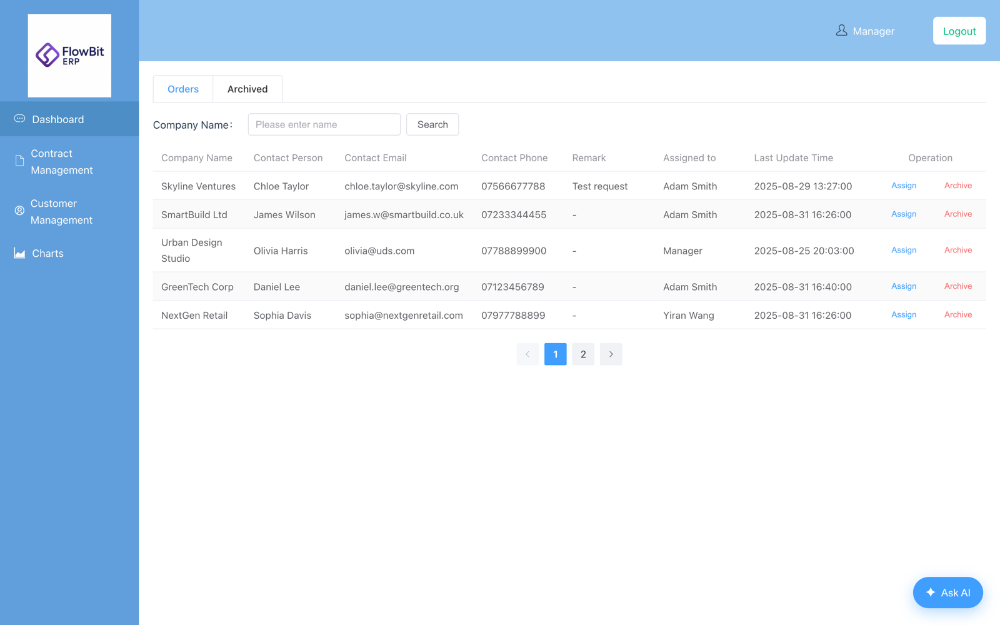
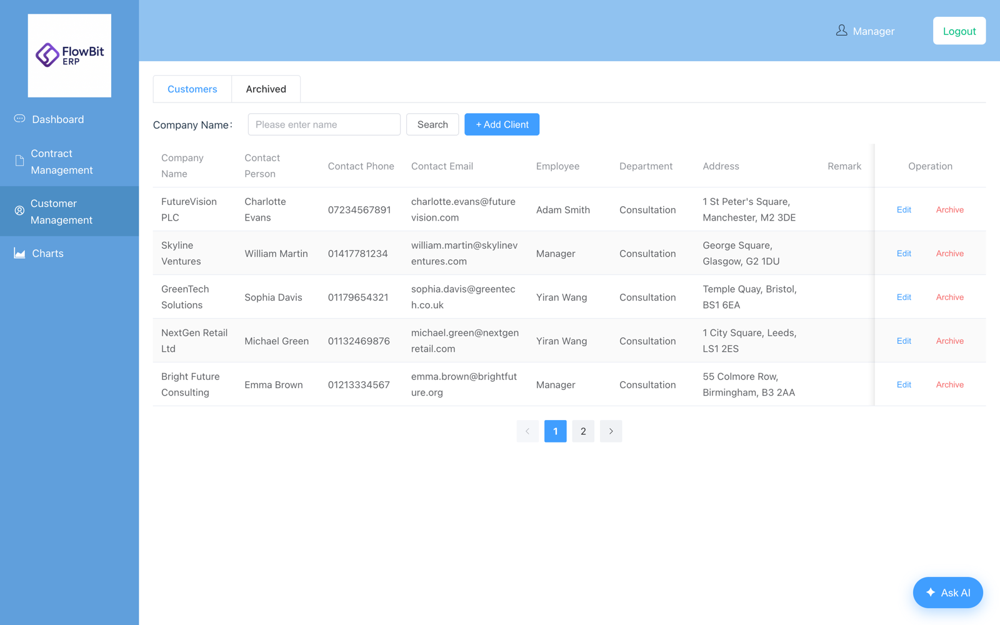
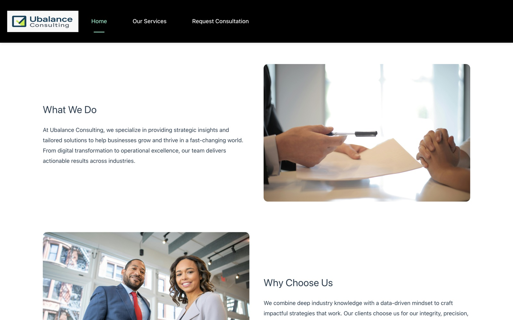
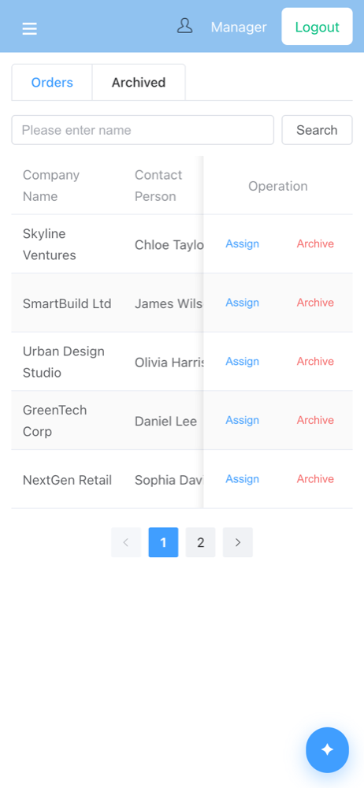
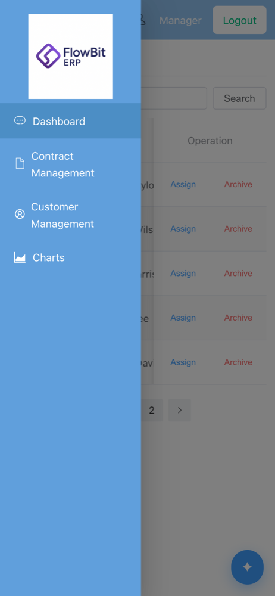
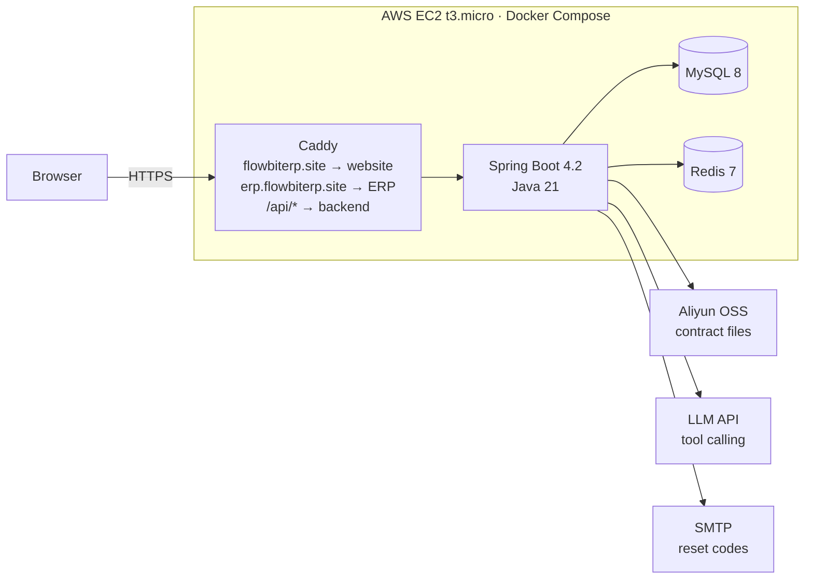
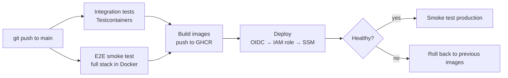

# FlowBit ERP

A full-stack ERP system for a consulting company: a public website where prospective clients request a consultation, and an internal ERP where managers assign those leads to consultants and the team manages clients, contracts and reports, with an AI assistant that answers questions from live data.

Started as my MSc dissertation project, then rebuilt for production: containerised, deployed by CI/CD, covered by integration tests, upgraded to Java 21 / Spring Boot 4, security-hardened, made mobile-friendly, and given a tool-calling AI assistant.

[](https://github.com/RRRRAN704/erp-fullstack-project/actions/workflows/build.yml)


**Live:** company website <https://flowbiterp.site> · ERP portal <https://erp.flowbiterp.site>

<p>
  
  
</p>
<p>
  
  
  
</p>

## Highlights

- **AI assistant built on LLM tool calling:** the model chooses among read-only Java "tools" (report statistics, client and contract search, unassigned orders), may call several per question, and writes the answer from their results, in the language of the question and with follow-up context. It never sees SQL, the tools apply the logged-in user's permissions, and the loop and each user's questions per minute are capped to protect the API budget.
- **Security hardening backed by attack tests:** record-level access checks against IDOR (you can only change what you can see, assign only within your reach, and the department is derived server-side), role rules declared with a `@RequireRole` annotation enforced by an aspect, brute-force-resistant password reset codes that don't reveal which emails have accounts, no secrets, codes or personal data in production logs. Every fix started with a test that showed the attack working.
- **CI/CD with no long-lived cloud credentials:** GitHub Actions runs the tests and an end-to-end smoke test, builds images to GHCR, then deploys through GitHub OIDC → an AWS IAM role → SSM Run Command. The deploy waits for health checks and rolls back automatically. SSH is closed.
- **Four containers on a 1 GB t3.micro:** Caddy (HTTPS for both sites), Spring Boot, MySQL and Redis, each with a memory limit and tuned settings, images built in CI rather than on the server.
- **Stepwise upgrade from Java 11 / Spring Boot 2.7 to Java 21 / Spring Boot 4.2:** via Boot 3.5 (`javax` → `jakarta`, springfox → springdoc, jjwt 0.9 → 0.13, Jackson 3), each step merged only with green tests and deployed separately.
- **89 integration tests** run the whole application against real MySQL and Redis in Docker (Testcontainers), from login and business flows to IDOR, role checks and the AI tool loop (with the LLM replaced by a scripted fake).
- **Works on phones:** below 768px the sidebar and website menu become drawers, tables scroll sideways with the actions column pinned, and dialogs and forms stack vertically; large pages were split into reusable components first.

## Features

**Public website** (`website-frontend`)
- Company pages and a consultation form (with a captcha); submissions arrive in the ERP as unassigned orders

**ERP: admin portal**
- Employees: create, edit, enable/disable accounts (new employees set their password via an emailed code)
- Departments and positions

**ERP: employee portal** (managers and consultants)
- **Orders:** managers see every website lead and assign it to a consultant in their department; consultants see the orders assigned to them; archive and restore
- **Clients and contracts:** consultants work on their own records, managers on their whole department; contract PDFs uploaded to object storage
- **Reports:** contracts signed, contract value, orders received and top 5 employees over a chosen date range (ECharts)
- **AI assistant:** a floating chat on every page. Ask "How many contracts did we sign last month, and what were they worth?", "Compare this month with last month" or "List my clients"; answers come from live data, scoped to what you're allowed to see
- Password reset by email code

## Architecture





## Tech stack

| Area | Technology |
|---|---|
| Backend | Java 21, Spring Boot 4.2, Spring MVC, MyBatis + PageHelper, JWT (jjwt), Spring AOP, Bean Validation, springdoc (dev only) |
| Data | MySQL 8 (HikariCP), Redis 7 (reset codes, rate limits) |
| Frontend | Vue 3, Vite, Element Plus, Pinia, ECharts, Axios |
| Integrations | Aliyun OSS (file uploads), OpenAI-compatible LLM API with tool calling, SMTP |
| Testing | JUnit 5, MockMvc, Testcontainers (MySQL, Redis), shell end-to-end smoke test |
| Infrastructure | Docker, Docker Compose, Caddy (automatic HTTPS), GitHub Actions, GHCR, AWS EC2 + IAM OIDC + SSM |

## Problems I solved

**A removed dependency broke production login, and the tests didn't notice.** While upgrading, I removed `jaxb-api` because nothing imported it. But the old JWT library called `javax.xml.bind.DatatypeConverter` at runtime, so login returned HTTP 500 in production for about an hour. The tests passed because `spring-boot-starter-test` puts a JAXB API on the *test* classpath only. I fixed it by moving to jjwt 0.13, then closed the gap: a CI job now starts the real images through Caddy and logs in, and I checked that it fails on the broken commit. Checking the rest of the dependency tree found a second victim: the Aliyun OSS SDK parses error responses with JAXB, now covered by its own test.

**Login failed only in my desktop browser.** After the Spring Boot 4.2 upgrade every API call from my desktop Chrome returned 500, while curl, CI and my phone worked. Tomcat 11 rejects requests whose `Accept-Language` header lists more than 10 locales, and that browser was configured with more. The fix was one property (`server.tomcat.max-locale-count`); the end-to-end test now logs in with a 15-locale header so it can't come back.

**Running four containers in 1 GB of RAM.** The first attempt hung the server when memory ran out. I added swap, moved image builds to CI, measured each container at idle and set limits from the measurements (MySQL 320 MB with a 64 MB buffer pool and performance schema off, the JVM sized by `MaxRAMPercentage` inside a 448 MB limit, Redis 48 MB, Caddy 64 MB).

**Bugs that only appeared on other people's machines.** The reports page showed "NaN" dates and every chart failed, but only in browsers set to British English: the date helpers parsed `toLocaleDateString()`, which is `24/11/2026` in en-GB and can't be parsed back. Rebuilt on calendar arithmetic with dayjs (which also fixed "This week" being wrong on Sundays). Similarly, the Vite starter stylesheet switched text to light grey for devices in dark mode, making the public website nearly unreadable on white pages for those visitors.

**The AI assistant answered about the wrong days.** The prompt never told the model today's date, so "last month" was resolved from its training data; and the code treated the end date as exclusive while the report queries include it, so answers named one day less than the data covered. Both are now pinned by tests, and the assistant was rebuilt on tool calling with the date, the user and their permissions in context.

**Tests exposed security holes.** Writing integration tests showed that any logged-in user could edit, archive or reassign another user's clients, contracts and orders just by sending their ids (IDOR), and that a reversed date range sent the report endpoint into an infinite loop. For each issue I first wrote a test that performed the attack successfully, then fixed the code until the test passed.

## Running locally

Requires Docker.

```bash
docker compose up --build
```

- Website: <http://localhost:8080>
- ERP: <http://localhost:8081> (seed accounts `admin`, `manager`, `yrwang` with password `123456`, local only)

Email, file upload and the AI assistant need real credentials in a git-ignored `.env` (names in `deploy/.env.example`); everything else works without them. `docker compose down -v` resets the database to the seed data.

Frontend with hot reload against that stack (ERP on <http://localhost:5173>, website on <http://localhost:3000>):

```bash
cd erp-frontend && npm install && npm run dev:docker
cd website-frontend && npm install && npm run dev:docker
```

Backend tests (JDK 21 and Docker):

```bash
cd erp-backend
mvn -pl ERP-Server -am verify
```

## Project structure

```
erp-backend/            Spring Boot, Maven multi-module
  ERP-Common/           constants, exceptions, JWT and other utilities, configuration properties
  ERP-Pojo/             entities, DTOs, VOs
  ERP-Server/           controllers, services, MyBatis mappers, security (AccessGuard, @RequireRole), AI assistant
  erp_project.sql       schema and seed data
erp-frontend/           ERP admin and employee portals (Vue 3)
website-frontend/       public company website (Vue 3)
deploy/                 production compose file, Caddy web image, end-to-end smoke test
.github/workflows/      CI/CD pipeline
docker-compose.yml      full stack for local development
```
